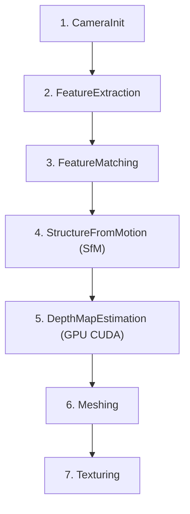

# AliceVision & Meshroom 3D Reconstruction Workspace

Chào mừng bạn đến với không gian làm việc tái tạo mô hình 3D (Photogrammetry) sử dụng hệ sinh thái mã nguồn mở **AliceVision / Meshroom**.

---

## 1. Giới thiệu Tổng quan (Overview)

* **AliceVision**: Là khung làm việc (Framework) thị giác máy tính chuyên sâu về Photogrammetry (tái tạo 3D từ ảnh chụp 2D). AliceVision cung cấp các thuật toán tiên tiến nhất về trích xuất đặc trưng, so khớp ảnh, Structure-from-Motion (SfM), và Multi-View Stereo (MVS).
* **Meshroom**: Là giao diện người dùng dựa trên nút lệnh (Node-based UI) và bộ điều phối thực thi được xây dựng trên nền tảng core engine của AliceVision, cho phép theo dõi, tùy biến và tự động hóa toàn bộ pipeline dựng hình 3D.

---

## 2. Hướng dẫn Kích hoạt Môi trường Conda (`alicevision`)

Dự án sử dụng môi trường Conda chuyên biệt **`alicevision`** (Python 3.10) được tích hợp sẵn các gói xử lý khoa học dữ liệu và hình ảnh (`jupyter`, `numpy`, `matplotlib`, `pillow`, `tqdm`).

### Cách kích hoạt qua Terminal (Zsh)
Bạn có thể sử dụng 1 trong 2 cách sau:

* **Cách 1: Lệnh đầy đủ tiêu chuẩn**
  ```bash
  conda activate alicevision
  ```
* **Cách 2: Sử dụng Alias nhanh (Đã cấu hình trong `~/.zshrc`)**
  ```bash
  ca_alice
  ```

### Cách kích hoạt trong Jupyter Notebook / VS Code
Khi tạo hoặc mở file `.ipynb`, bấm vào bộ chọn Kernel ở góc trên bên phải và chọn:
👉 **`Python (AliceVision)`**

---

## 3. Cách Sử dụng AliceVision (CLI vs GUI)

### A. Sử dụng dòng lệnh CLI / Batch Mode (Khuyên dùng cho Server hoặc Tự động hóa)
Bạn có thể chạy toàn bộ quy trình tự động từ tập ảnh chụp ra mô hình 3D hoàn chỉnh chỉ với một lệnh `meshroom_batch`:

```bash
cd /home/dacekey/dariusuav/alicevision

# Ví dụ chạy dự án P01_first-practice
./Meshroom-2023.3.0/meshroom_batch \
    --input ./project/P01_first-practice/images \
    --output ./project/P01_first-practice/output
```

*Hoặc* bạn có thể lập trình gọi từng Node riêng lẻ trong thư mục `Meshroom-2023.3.0/aliceVision/bin/` (ví dụ: `aliceVision_cameraInit`, `aliceVision_featureExtraction`, v.v.) bằng Python bên trong Jupyter Notebook.

### B. Sử dụng Giao diện Đồ họa GUI (Khi chạy trên Desktop Linux có X11 Display)
```bash
cd /home/dacekey/dariusuav/alicevision/Meshroom-2023.3.0
PYTHONPATH=$PWD ./Meshroom
```
Sau khi giao diện Meshroom hiện lên:
1. Kéo thả thư mục chứa ảnh vào bảng **Images** bên trái.
2. Bấm nút **Start** ở menu trên cùng để bắt đầu tính toán mô hình 3D.

---

## 4. Pipeline Tiêu chuẩn Thực hiện Một Dự án (Standard Pipeline)

Một dự án Photogrammetry tiêu chuẩn chuyển đổi từ ảnh 2D sang mô hình 3D sẽ tuần tự đi qua 7 bước cốt lõi sau:



### Bảng tóm tắt luồng dữ liệu Pipeline:

| Bước | Tên Node CLI | Chức năng chính | Dữ liệu đầu ra | Yêu cầu GPU |
| :---: | :--- | :--- | :--- | :---: |
| **1** | `aliceVision_cameraInit` | Đọc EXIF & thông số cảm biến máy ảnh | File cấu hình `cameraInit.sfm` | CPU |
| **2** | `aliceVision_featureExtraction` | Trích xuất điểm đặc trưng (SIFT/AKAZE) | Keypoints & Descriptors (`.feat`, `.desc`) | CPU |
| **3** | `aliceVision_featureMatching` | So khớp các điểm tương đồng giữa các ảnh | Cặp ảnh ghép nối (`matches/`) | CPU |
| **4** | `aliceVision_incrementalSfM` | Tính toán tọa độ camera & đám mây điểm thô | Sparse Point Cloud (`sfm.abc`) | CPU |
| **5** | `aliceVision_depthMapEstimation` | Tính bản đồ độ sâu đa góc nhìn (MVS) | Bản đồ độ sâu chi tiết (`.exr`) | **NVIDIA CUDA** |
| **6** | `aliceVision_meshing` | Nối đám mây điểm thành lưới tam giác 3D | Lưới đa giác thô (`mesh.obj`) | CPU |
| **7** | `aliceVision_texturing` | Chiếu màu ảnh gốc lên bề mặt lưới 3D | Mô hình 3D hoàn chỉnh (`texturedMesh.obj` + `.png`) | CPU |

### Giải thích chi tiết 7 bước:
1. **CameraInit (Khởi tạo máy ảnh)**: Quét toàn bộ metadata EXIF của tập ảnh đầu vào để định danh thiết bị chụp, tiêu cự và kích thước cảm biến hình ảnh.
2. **FeatureExtraction (Trích xuất đặc trưng)**: Phân tích từng bức ảnh để nhận dạng hàng nghìn điểm đặc trưng độc nhất (Keypoints/Descriptors).
3. **FeatureMatching (So khớp đặc trưng)**: Đối chiếu các điểm đặc trưng giữa các cặp ảnh có độ chồng lấn (overlap) để tìm ra các điểm tương ứng.
4. **StructureFromMotion - SfM (Tái tạo cấu trúc từ chuyển động)**: Giải bài toán hình học không gian để tìm ra tọa độ và góc nhìn chính xác của máy ảnh lúc chụp, đồng thời dựng lên đám mây điểm thô (Sparse Point Cloud).
5. **DepthMapEstimation (Ước lượng bản đồ độ sâu - MVS)**: *Yêu cầu GPU NVIDIA CUDA*. Tính toán chi tiết chiều sâu cho từng điểm pixel trên các góc chụp, tạo thành đám mây điểm dày đặc (Dense Point Cloud).
6. **Meshing (Dựng lưới 3D)**: Kết nối đám mây điểm dày đặc thành một khối bề mặt lưới đa giác tam giác 3D êm mượt (Mesh).
7. **Texturing (Trải vân bề mặt vật liệu)**: Phủ màu sắc và họa tiết từ ảnh chụp 2D thực tế lên bề mặt mô hình lưới 3D, xuất ra file chuẩn `.obj` kèm file vật liệu `.mtl` và texture `.png`.
